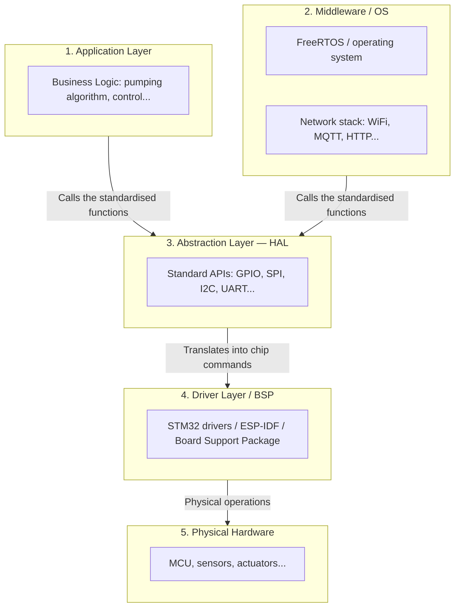

# Hardware Abstraction Layer (HAL) in IoT Architecture

**Created Date:** 2026-09-21
**Last Updated:** 2026-09-28
**Tags:** `#iot_aiot`, `#embedded-systems`, `#system-architecture`, `#testing`
**References:** Discussion on Mocking, Unit Testing, and Profiling in Embedded Systems
**Status:** Published
**Difficulty:** Advanced

---

## 📌 Key Takeaways (TL;DR)
- **HAL (Hardware Abstraction Layer)** is an intermediate software layer that *hides* the complexity of hardware communication from the application layer.
- **Superpower 1 (portability):** it makes the code hardware-independent. Swapping the MCU from an STM32 to an ESP32 only requires rewriting the HAL; the application logic stays 100% unchanged.
- **Superpower 2 (testability):** it makes it possible to build a "mock HAL" so unit tests and simulations run on a PC (in CI/CD) with no real board required.
- **Easy profiling:** timing (latency) code can be *injected* into the HAL layer without polluting the core algorithm.

## 🧠 Detailed Notes

### 1. Where the HAL sits in an IoT software architecture
In an embedded system, the HAL is the lowest software layer, sitting directly on top of the hardware drivers. The application layer and middleware must never talk to the driver layer directly — they have to go through the HAL.



### 2. Simulating the HAL architecture (Implementation)
Below is a simulation of how the HAL isolates an algorithm from the hardware.

**A. Interface file (`hal_temperature.h`)**
```c
#ifndef HAL_TEMPERATURE_H
#define HAL_TEMPERATURE_H
float HAL_TempSensor_Read(void); // The application layer only sees this function
#endif
```

**B. Application layer (`app_logic.c` — hardware-independent)**
```c
#include "hal_temperature.h"
#include "hal_fan.h"

void App_CoolingSystem_Task(void) {
    float currentTemp = HAL_TempSensor_Read();
    if (currentTemp > 35.0) {
        HAL_Fan_SetState(true);
    }
}
```

**C. Mock implementation so it can be tested on a PC (`hal_mock_impl.c`)**
```c
#include "hal_temperature.h"
#include <stdio.h>

static float mock_temperature = 25.0;

void Test_SetMockTemperature(float temp) {
    mock_temperature = temp; // Test scenario injected from a PC / JSON
}

float HAL_TempSensor_Read(void) {
    printf("[MOCK] Reading simulated temperature: %.2f°C\n", mock_temperature);
    return mock_temperature;
}
```

### 3. Simulator signals: where the fake data comes from
Where the mock HAL layer gets its fake signals from depends on the **scope of testing**:

1. **Local unit test:** read the fake signal from a JSON/CSV file on the PC and write the log to a `.log` file. The goal is to check the algorithm quickly (CI/CD pipeline).
2. **End-to-end test (system test):** the mock HAL joins the network, receives signals from a simulated scenario pushed through an MQTT broker (such as AWS IoT Core). After the algorithm makes its decision, the control command (JSON) is published by the mock HAL back to AWS IoT, so the whole system flow can be verified.

### 4. Performance measurement (latency & profiling)
The HAL provides an ideal injection point for measuring signal-reception and processing speed without touching the application logic:

- **Application logic latency:** insert a timer in the application layer around `App_CoolingSystem_Task()` while running the mock HAL.
- **Hardware read latency:** use a *GPIO toggle* technique inside `hal_stm32_impl.c` together with an oscilloscope to measure the physical delay when reading a sensor.
- **Network latency:** in the end-to-end scenario, put a `timestamp` into the JSON payload from AWS IoT; the mock HAL reads the current time and subtracts that `timestamp` to compute the network latency.

## 📝 Research Journey
- **Why:** I needed to understand where the HAL sits in an IoT architecture in order to design larger projects (such as TBS) so they scale easily and stay testable.
- **Struggle:** at first it was hard to tell apart the vendor's chip driver layer from the project's own HAL layer, and it was unclear where the simulator signals should come from.
- **Aha moment:** the HAL is the core of bringing Agile and CI/CD down to hardware. Every signal flow (whether from internal JSON or from AWS IoT Core) can be "pumped in" through the mock HAL without the algorithm ever knowing. Injecting a timer into the HAL is also the most elegant way to profile.
- **Career link:** mastering this design pattern is a mandatory step from Embedded Junior to Senior/System Architect, because it enforces a clear boundary between Edge and Cloud.

## 🔗 Related Topics
- [[../vocabulary/02-agile-iot-project-management-terminology.md]] — baseline definitions of HAL and the Agile spike
- [[02-mqtt-simulation-testing-system.md]] — a Python system that plays the role of pushing simulated signals down to the mock HAL through the cloud
- [[04-esp32-psram-vs-internal-sram.md]] — the hardware-architecture counterpart: a HAL is a software boundary, PSRAM is a hardware one
- [SUGGESTED] Driver Abstraction Layer (DAL) — should a growing project split the HAL into smaller layers?

## 🤔 Open Questions
- [ ] As a project grows, should the HAL be split into smaller layers (such as a Device Abstraction Layer, DAL)?
- [ ] When clock synchronisation (NTP) between the Edge device and AWS IoT is used to measure network latency, do temporary disconnections introduce measurable error?

---
*Good architecture lets you postpone hardware decisions for as long as possible.*
