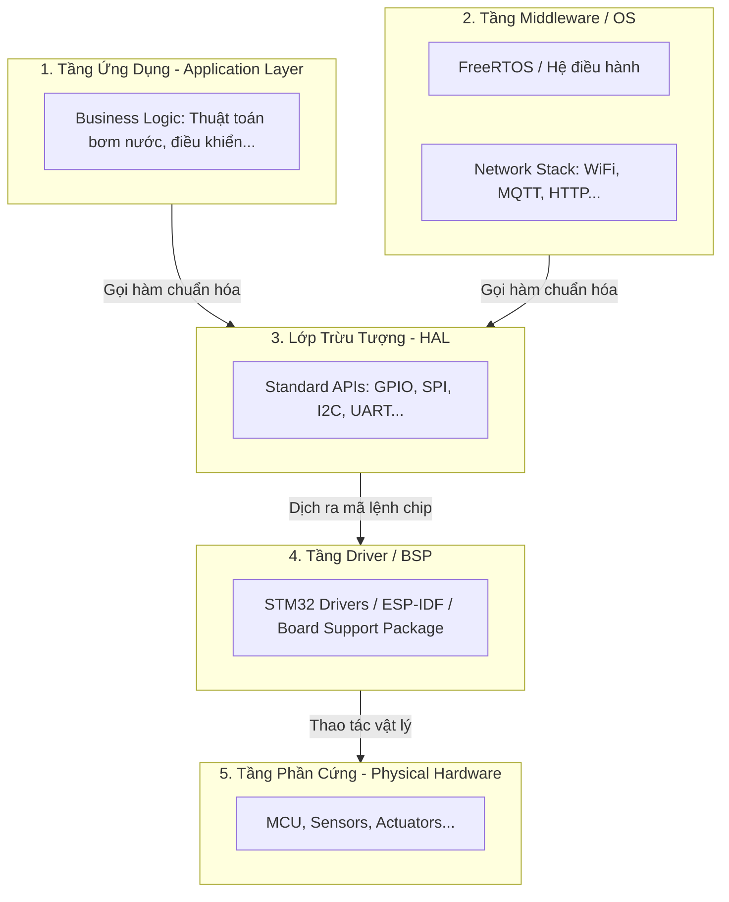

# Hardware Abstraction Layer (HAL) in IoT Architecture

**Created Date:** 2026-09-21
**Last Updated:** 2026-09-21
**Tags:** `#iot_aiot`, `#embedded-systems`, `#system-architecture`, `#testing`
**References:** Discussion on Mocking, Unit Testing, and Profiling in Embedded Systems
**Status:** Published
**Difficulty:** Advanced

---

## 📌 Key Takeaways (TL;DR)
- **HAL (Hardware Abstraction Layer)** là một lớp phần mềm trung gian giúp "che giấu" chi tiết giao tiếp phần cứng phức tạp khỏi tầng ứng dụng (Application Layer).
- **Siêu năng lực 1 (Portability):** Giúp code độc lập với phần cứng. Đổi MCU từ STM32 sang ESP32 chỉ cần viết lại HAL, logic ứng dụng giữ nguyên 100%.
- **Siêu năng lực 2 (Testability):** Cho phép tạo "Mock HAL" để chạy Unit Test và mô phỏng trên máy tính PC (CI/CD) mà không cần bo mạch thật.
- **Dễ dàng Profiling:** Cho phép "tiêm" (inject) code đo thời gian (latency) vào lớp HAL mà không làm bẩn thuật toán cốt lõi.

## 🧠 Detailed Notes

### 1. Vị trí của HAL trong Kiến trúc phần mềm IoT
Trong hệ thống nhúng, HAL nằm ở tầng dưới cùng của phần mềm, ngay trên Hardware Drivers. Tầng Ứng dụng và Middleware tuyệt đối không được giao tiếp trực tiếp với Tầng Driver mà phải qua HAL.



### 2. Mô phỏng Kiến trúc HAL (Implementation)
Dưới đây là mô phỏng cách HAL cô lập thuật toán khỏi phần cứng.

**A. File Interface (`hal_temperature.h`)**
```c
#ifndef HAL_TEMPERATURE_H
#define HAL_TEMPERATURE_H
float HAL_TempSensor_Read(void); // Tầng ứng dụng chỉ thấy hàm này
#endif
```

**B. Tầng Ứng Dụng (`app_logic.c` - Không phụ thuộc phần cứng)**
```c
#include "hal_temperature.h"
#include "hal_fan.h"

void App_CoolingSystem_Task(void) {
    float currentTemp = HAL_TempSensor_Read();
    if (currentTemp > 35.0) {
        HAL_Fan_SetState(true);
    }
}
```

**C. Thực thi Mocking để Test trên PC (`hal_mock_impl.c`)**
```c
#include "hal_temperature.h"
#include <stdio.h>

static float mock_temperature = 25.0; 

void Test_SetMockTemperature(float temp) {
    mock_temperature = temp; // Kịch bản test từ PC / JSON
}

float HAL_TempSensor_Read(void) {
    printf("[MOCK] Đang đọc nhiệt độ giả lập: %.2f°C\n", mock_temperature);
    return mock_temperature; 
}
```

### 3. Simulator Signals: Nơi ghi nhận tín hiệu
Việc lấy tín hiệu giả cho lớp Mock HAL phụ thuộc vào **Scope of Testing**:
1. **Unit Test Cục Bộ (Local):** Đọc tín hiệu giả từ 1 file JSON/CSV trên máy tính, lưu log ra file `.log`. Mục tiêu để kiểm tra nhanh thuật toán (CI/CD pipeline).
2. **End-to-End Test (System Test):** Mock HAL kết nối mạng, nhận tín hiệu từ một kịch bản giả lập đẩy qua MQTT Broker (như AWS IoT Core). Sau khi thuật toán ra quyết định, lệnh điều khiển (JSON) lại được Mock HAL publish ngược lên AWS IoT để kiểm tra toàn luồng hệ thống.

### 4. Đo lường hiệu năng (Latency & Profiling)
HAL cung cấp một điểm chèn tuyệt vời để đo tốc độ nhận tín hiệu và xử lý mà không thay đổi logic ứng dụng:
- **Application Logic Latency:** Chèn timer ở Tầng ứng dụng quanh hàm `App_CoolingSystem_Task()` khi chạy Mock HAL.
- **Hardware Read Latency:** Dùng kỹ thuật *Toggle GPIO* bên trong `hal_stm32_impl.c` kết hợp máy Oscilloscope để đo độ trễ vật lý khi đọc cảm biến.
- **Network Latency:** Ở kịch bản End-to-End, nhét `timestamp` vào JSON payload từ AWS IoT, Mock HAL lấy thời gian hiện tại trừ đi `timestamp` đó để tính độ trễ mạng.

## 📝 Research Journey
- **Why:** Cần hiểu rõ vị trí của HAL trong kiến trúc IoT để thiết kế các dự án lớn (như TBS) sao cho dễ scale và dễ test.
- **Struggle:** Ban đầu khó phân biệt giữa Tầng Driver của hãng chip và lớp HAL của dự án. Không rõ simulator signals lấy từ đâu.
- **Aha moment:** HAL chính là cốt lõi để mang Agile và CI/CD vào phần cứng. Mọi luồng tín hiệu (từ JSON nội bộ hay từ AWS IoT Core) đều có thể được "bơm" vào qua Mock HAL mà thuật toán không hề hay biết. Chèn timer vào HAL cũng là cách profiling thanh lịch nhất.
- **Career link:** Nắm vững Design Pattern này là yếu tố bắt buộc để từ Embedded Junior lên Senior/System Architect, đảm bảo ranh giới rõ ràng giữa Edge và Cloud.

## 🔗 Related Topics
- [[../vocabulary/02-agile-iot-project-management-terminology.md]] — Định nghĩa cơ bản về HAL và Agile Spike.
- [[02-mqtt-simulation-testing-system.md]] — Hệ thống Python đóng vai trò đẩy tín hiệu giả lập xuống Mock HAL qua Cloud.

## 🤔 Open Questions
- [ ] Khi dự án phình to, có nên chia HAL thành các layer nhỏ hơn (như Device Abstraction Layer - DAL) không?
- [ ] Việc đồng bộ đồng hồ (NTP) giữa thiết bị Edge và AWS IoT để đo Network Latency có bị sai lệch khi ngắt kết nối tạm thời không?

---
*Kiến trúc tốt là kiến trúc cho phép bạn trì hoãn các quyết định về phần cứng càng lâu càng tốt.*
