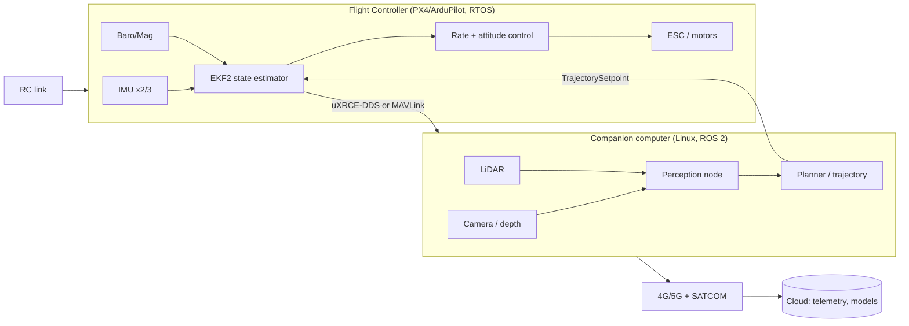

# UAV as an IoT System: Onboard Stack, C2 Links and Airspace Integration

**Created Date:** 2026-10-30
**Last Updated:** 2026-10-30
**Tags:** `#uav`, `#iot`, `#c2-link`, `#mavlink`, `#px4`, `#ros2`, `#bvlos`, `#remote-id`, `#edge-computing`, `#drone-delivery`
**References:** FAA BVLOS NPRM (Aug 2025) · UK CAA C2 Link policy concept (2024) · EASA SORA / U-space · PX4 & ArduPilot companion-computer docs · MAVLink developer guide · Serve Robotics investor material (2026)
**Status:** Review
**Difficulty:** Intermediate → Advanced

---

## 📌 Key Takeaways (TL;DR)

- A drone is **not** "an ESP32 with propellers". It is a **safety-critical real-time control system with a radio link that can disappear**. IoT thinking (publish telemetry to a broker) applies to the *outer* loop; the *inner* loop must never depend on the network.
- The architecture is always a **two-computer split**: a deterministic **flight controller** (PX4/ArduPilot, ~1 kHz loops, certified-ish firmware) and a general-purpose **companion computer** (Jetson / Raspberry Pi, Linux, ROS 2, AI). One flies the aircraft, the other thinks. Confusing the two is the most common beginner design error.
- **C2 (Command and Control) link** is the UAV's oxygen: uplink commands + downlink telemetry. Its four measurable properties are **availability, continuity, integrity, latency** — not just "range in km".
- Every C2 technology is a trade-off: ISM radio (cheap, short, unlicensed), 4G/5G (long range, but handover latency and 120 m AGL practical ceiling), 5 GHz protected LoS (robust, rare), satellite (global, high latency/low bandwidth). **Production fleets use at least two, with automatic failover.**
- Regulation is now the binding constraint in most markets: **Remote ID** is mandatory in the US (Part 89), **BVLOS** is moving to a performance-based rule (proposed Part 108, NPRM published August 2025), and Europe uses **SORA + U-space**. A "technically flyable" design that has no C2 robustness argument is not deployable.
- Data pipeline consequence: the fleet must be designed **offline-first** — buffer onboard, upload on reconnect, and treat the cloud as an *observer*, never as part of the control loop.

---

## 🧠 Detailed Notes

### 1. Core Concepts

#### 1.1 Vocabulary that people mix up

| Term | Expansion | What it actually means | Why the distinction matters |
|------|-----------|------------------------|-----------------------------|
| **UA** | Unmanned Aircraft | The flying vehicle alone | Certification applies to the *aircraft* |
| **UAS** | Unmanned Aircraft System | UA + ground control station + C2 link + operator + procedures | Safety cases are written for the whole system, not the vehicle |
| **UAV** | Unmanned Aerial Vehicle | Same as UA, more common in research literature | Papers say UAV; regulators say UA/UAS |
| **GCS** | Ground Control Station | The laptop/tablet/software the pilot uses | GCS loss ≠ aircraft loss if failsafes are configured |
| **C2** | Command and Control (link) | The bidirectional channel carrying commands up and telemetry down | The single point of failure with the worst failure mode |
| **C3** | Command, Control and Communications | C2 + the communication service supporting ATC interaction | EASA terminology; includes the *service*, not just the radio |
| **UTM** | UAS Traffic Management | Digital traffic management for low-altitude airspace | You do not "see and avoid" other drones; UTM brokers the deconfliction |
| **BVLOS** | Beyond Visual Line of Sight | Operating when the pilot cannot see the aircraft | Requires a safety case; this is where C2 and DAA become mandatory |
| **DAA** | Detect and Avoid | Onboard/offboard sensing that replaces the human eye | The technical substitute for "see and avoid" |
| **SORA** | Specific Operations Risk Assessment | JARUS/EASA method to classify risk (SAIL I–VI) and derive mitigations | Explains *why* a given drone needs redundant C2 |
| **Remote ID** | Remote Identification | Broadcast/network identity + position + operator ID | Law-enforcement and UTM visibility; Part 89 in the US |

> **Naming trap for the logistics literature.** In the drone-delivery papers, **SUGV** is used for *Sidewalk Unmanned Ground Vehicle* (a pavement delivery robot). In defence robotics, "SUGV" almost always means *Small Unmanned Ground Vehicle* — the US Army programme was built on iRobot's PackBot platform. Same acronym, different machine and different risk profile. When you read a paper, check the definition before reusing the term.

#### 1.2 Why a UAV is a different kind of IoT device

Ordinary IoT devices are **stationary, low-stakes, mains- or coin-cell-powered, and loss-tolerant**. A delivery UAV violates every one of those assumptions:

| Dimension | Typical IoT node | UAV | Design consequence |
|-----------|------------------|-----|--------------------|
| Mobility | Fixed | 3D, 10–25 m/s, 120 m altitude | Handover, Doppler, multipath, geofence |
| Failure cost | Lost reading | Lost aircraft / injured person | Redundancy, failsafes, certification |
| Power | Mains / months on a coin cell | 15–40 min flight on a LiPo pack | Compute budget is measured in watts *and grams* |
| Link | Stable Wi-Fi/LoRa | Intermittent, variable latency, can vanish | Offline-first, store-and-forward |
| Compute | MCU at MHz | MCU at kHz loop + GPU at TOPS | Two-computer split |
| Update | OTA occasionally | OTA is a flight-safety change | Version pinning, staged rollout |
| Regulation | EMC only | Airspace, privacy, noise, certification | Non-technical gate that blocks shipping |

The mental model that works: **the UAV is a real-time control system wearing an IoT costume.**

#### 1.3 The five planes of a UAV system

```
┌─────────────────────────────────────────────────────────────┐
│ 5. Operations plane   fleet mgmt · UTM · remote ops · logs  │
├─────────────────────────────────────────────────────────────┤
│ 4. Cloud plane        telemetry lake · model registry · OTA  │
├─────────────────────────────────────────────────────────────┤
│ 3. Comms plane        C2 link(s) · Remote ID · payload link  │
├─────────────────────────────────────────────────────────────┤
│ 2. Autonomy plane     companion computer · perception · plan │
├─────────────────────────────────────────────────────────────┤
│ 1. Flight plane       flight controller · IMU · actuators    │
└─────────────────────────────────────────────────────────────┘
        sensors ──► estimate ──► decide ──► actuate
```

The **cut between plane 1 and plane 2** is the most important design line in the whole system. Everything above it may crash, reboot, or lose the network; the aircraft must still hover or return home.

#### 1.4 Edge vs cloud: what belongs where

| Function | Onboard (edge) | Cloud | Reason |
|----------|----------------|-------|--------|
| Attitude stabilisation | ✅ | ❌ | 1 kHz loop, network impossible |
| Position estimation (EKF2) | ✅ | ❌ | Latency + link loss |
| Obstacle avoidance | ✅ | ❌ | Milliseconds matter |
| Object detection | ✅ (small model) | ⚠️ optional | Bandwidth + privacy; cloud used for hard cases |
| Route optimisation | ⚠️ re-planning | ✅ global plan | Global VRP is heavy; onboard does local repair |
| Map building | ✅ local | ✅ global fusion | Photogrammetry is compute-heavy |
| Model training | ❌ | ✅ | Power and data volume |
| Audit / compliance logs | ✅ buffer | ✅ archive | Legal retention; must survive link loss |

---

### 2. How It Works (Mechanism)

#### 2.1 The control-loop hierarchy

A multirotor is unstable without continuous correction. Control is a **cascade**: each layer runs slower than the one inside it.

| Loop | Typical rate | Runs on | Job | If it stops |
|------|--------------|---------|-----|-------------|
| Motor/ESC (FOC) | 8–48 kHz | ESC | Current/torque control | Motor stops |
| Rate (angular velocity) | 500–1000 Hz | Flight controller | Stabilise rotation | Aircraft tumbles |
| Attitude (angle) | 250–500 Hz | Flight controller | Hold roll/pitch/yaw | Drift, crash |
| Velocity / position | 50–100 Hz | Flight controller (EKF2) | Hold position, follow setpoints | Drift with wind |
| Offboard setpoint stream | ≥ 2 Hz (PX4 minimum) | Companion computer | High-level guidance | PX4 triggers failsafe |
| Mission / waypoint | 0.1–1 Hz | Autopilot or GCS | Route following | Continues last mission |
| Telemetry to cloud | 1–10 Hz (decimated) | Companion / LTE modem | Monitoring | No operator visibility |

**Why the offboard ≥ 2 Hz rule matters.** PX4 refuses to enter or stay in `OFFBOARD` mode if the setpoint stream stalls, because a silently dead companion computer is indistinguishable from a frozen guidance law. The 2 Hz floor is a *liveness proof*, not a control rate. Design your node so a blocked thread cannot starve the publisher — a classic bug is doing heavy inference on the same executor that publishes setpoints.

#### 2.2 Time synchronisation (the invisible requirement)

Sensor fusion is only as good as its timestamps.

- Camera–IMU offset above ~1 ms visibly degrades VIO at 10 m/s.
- PTP / gPTP (IEEE 1588) over Ethernet gives sub-microsecond sync on the companion computer; hardware timestamping on the NIC is what makes it real.
- MAVLink telemetry timestamps are *arrival* timestamps, not *acquisition* timestamps — do not fuse them as if they were sensor time.
- For log-based reconstruction, record monotonic clock + boot ID; wall-clock jumps (NTP corrections) will otherwise create negative time deltas in your dataset.

#### 2.3 The software buses: MAVLink vs ROS 2 / DDS

| Bus | Role | Transport | Strengths | Weaknesses |
|-----|------|-----------|-----------|------------|
| **MAVLink** | Vehicle protocol (FC ↔ companion ↔ GCS) | Serial, UDP, TCP | Tiny header, huge ecosystem, mission protocol built in | Weak typing at scale, no discovery, auth optional |
| **uXRCE-DDS** | PX4 ↔ ROS 2 bridge | Serial / Ethernet | Native ROS 2 topics, low overhead | PX4-specific setup |
| **MAVROS** | MAVLink ↔ ROS 1/2 bridge | Serial / UDP | Mature, ArduPilot-friendly | Extra translation hop |
| **DDS (ROS 2)** | Inter-node pub/sub onboard | UDP multicast | Typed messages, QoS, discovery | Chatty on constrained links; QoS misconfiguration causes silent message loss |

MAVLink 2 frames are compact: 10-byte header (magic, length, incompatibility, compatibility, sequence, system ID, component ID, 24-bit message ID) + payload + 2-byte checksum. A `ATTITUDE` message carries 28 bytes of payload; at 50 Hz that is

$$
(10 + 28 + 2)\ \text{B} \times 50\ \text{Hz} = 2000\ \text{B/s} \approx 16\ \text{kbit/s}
$$

— trivial on LTE, but not trivial on a 9.6 kbit/s long-range telemetry radio shared with 30 other messages. This is why telemetry to the cloud is **decimated and aggregated**, never a raw MAVLink firehose.

#### 2.4 Link budget: the only honest way to talk about "range"

Free-space path loss (FSPL), with distance $d$ in km and frequency $f$ in MHz:

$$
\text{FSPL(dB)} = 20\log_{10} d + 20\log_{10} f + 32.44
$$

Received power:

$$
P_{rx} = P_{tx} + G_{tx} + G_{rx} - \text{FSPL} - L_{misc}
$$

Feasible when $P_{rx} \ge S_{rx} + M$, where $S_{rx}$ is receiver sensitivity and $M$ the fade margin (6–20 dB in urban clutter).

**Worked example.** 2.4 GHz, $P_{tx}=20$ dBm, $G_{tx}=G_{rx}=2$ dBi, $S_{rx}=-95$ dBm, $M=10$ dB, $L_{misc}=3$ dB:

$$
\text{Allowed FSPL} = 20+2+2-(-95)-10-3 = 106\ \text{dB}
$$

$$
20\log_{10} d = 106 - 20\log_{10}(2400) - 32.44 = 106 - 67.6 - 32.44 = 5.96
\Rightarrow d \approx 10^{0.298} \approx 1.99\ \text{km}
$$

So a "10 km" marketing number usually assumes free space, zero margin, and a directional antenna on a mast. In an urban canyon the same link dies at 1–2 km. **Always state the margin.**

#### 2.5 C2 link technologies compared

| Technology | Range | Bandwidth | Latency | Robustness | Cost / SWaP | Typical use |
|------------|-------|-----------|---------|------------|-------------|-------------|
| **ISM band** (433/868/915 MHz, 2.4 GHz) | 1–15 km LoS | Low (kbit/s) | Low | Poor (unlicensed interference) | Very low | RC control, backup telemetry, hobby |
| **5 GHz protected LoS** | 10–30 km | Medium | Low | High (aviation-protected band) | High | Trials, BVLOS corridor operations |
| **4G/LTE** | Unlimited (network) | Medium–high | 30–100 ms, spikes on handover | Medium | Low SWaP, SIM cost | Urban BVLOS, video, teleop |
| **5G** | Unlimited | High | 10–30 ms (ideal) | Medium–high | Medium | Dense urban, remote driving |
| **MSS** (L-band satellite) | Global | Very low | 500 ms–2 s | Very high | High | Over-water, remote, backup C2 |
| **LEO broadband** (e.g. Starlink-class) | Global | High | 30–60 ms | Medium (rain fade) | High SWaP | Long-endurance BVLOS |
| **SATCOM + LTE dual** | Global + local | Combined | Mixed | Highest | Highest | Certified BVLOS delivery |

Practical rule from regulators (UK CAA C2 policy concept): when C2 is routed over the public internet, require an authenticated, encrypted tunnel (≥ 128-bit AES for SAIL 1–3), log link quality (RSSI/RSRP/CQI, latency, handover spikes), and prefer UAS-specific SIM plans. Also note the practical **120 m (400 ft) AGL ceiling** for terrestrial cellular C2 before interference and antenna-pattern issues dominate.

#### 2.6 Redundancy, failover, and failsafe design

A production C2 design is a **state machine**, not a single radio:

```
        ┌──────────── link healthy (primary) ────────────┐
        │                                                ▼
   [PRIMARY 4G] ──loss>500 ms──► [SECONDARY SAT/ISM] ──loss──► [FAILSAFE]
        ▲                              │                         │
        └──── recovered <2 s ──────────┘                         │
                                                                  ▼
                                          HOLD → RTL → LAND (geofenced)
```

Layered defences:

1. **Link layer** — dual modem, different operators, different bands; make-before-break handover.
2. **Protocol layer** — heartbeat monotonic counter; MAVLink 2 *signing* to reject injected packets.
3. **Autopilot layer** — data-link-loss (DL) failsafe with configurable timeout; RC override always wins; geofence breach → RTL.
4. **Mission layer** — the aircraft must be able to complete or abort a delivery with **zero** cloud contact.
5. **Ground layer** — operator alerting on degraded link *before* it fails (predictive, from RSRP trend).

The IoT analogue is **Last Will and Testament** in MQTT (see `02-mqtt-simulation-testing-system.md`): if the broker stops receiving keep-alives, it publishes a death notice. A UAV needs the same idea at two levels: the cloud notices the aircraft vanished, *and* the aircraft notices the cloud vanished. Only the second one can save the vehicle.

#### 2.7 Airspace integration: the non-negotiable layer

- **Remote ID (US, Part 89):** broadcast identity, location, altitude, velocity, operator location. Broadcast (Bluetooth/Wi-Fi) or network publication. Applies to essentially all operations in the NAS.
- **BVLOS rulemaking (US):** FAA/TSA NPRM *Normalizing UAS BVLOS Operations* was published 2025-08-07 (comments closed 2025-10-06), proposing performance-based rules and a new **Part 108**, including third-party services such as **UTM**. Treat the final rule as pending; design to the *performance* requirements (C2 robustness, DAA, lighting, Remote ID) rather than to a specific paragraph number.
- **Europe:** EASA U-space regulations (2021/664–666) plus **SORA** for the specific category. SORA's **OSO 13** ("external services supporting UAS operations are adequate") is where C2 link evidence lives: availability, continuity, integrity, latency.
- **China:** Shenzhen is the reference deployment — a commercial operator reported >100,000 drone deliveries in 2022, i.e. routine urban BVLOS at scale before Western rules matured.
- **UTM** is the digital layer that replaces "look out of the window": flight intent sharing, geo-fencing, conflict detection, and (increasingly) weather and noise constraints.

#### 2.8 Security threat model (short, because it is a whole note elsewhere)

| Threat | Vector | Impact | Mitigation |
|--------|--------|--------|------------|
| GPS spoofing / jamming | RF | Wrong position → fly-away or forced landing | Multi-constellation GNSS, VIO/visual odometry fallback, IMU dead-reckoning, spoof detection |
| MAVLink injection | Open UDP/TCP port | Attacker sends commands | MAVLink 2 signing, VPN/TLS, no public ports, allow-list GCS IDs |
| C2 hijack / takeover | Compromised LTE modem | Full control loss | Mutual auth, SIM pinning, modem firewall, hardware root of trust |
| Telemetry privacy leak | Unencrypted cloud storage | Faces, plates, routes exposed | Encryption at rest, retention limits, on-device redaction |
| Supply-chain firmware | Third-party module | Persistent backdoor | Signed firmware, secure boot, reproducible builds |
| Model poisoning (AI stack) | Malicious OTA update | Silent behavioural change | Signed model artefacts, staged rollout, shadow mode |

Cross-reference: the web-security notes (`../dev_foundation/security/`) cover injection/XSS/CSRF for the ground segment; the UAV adds the *physical* consequence dimension.

---

### 3. Implementation

#### 3.1 Link-budget calculator (runnable)

```python
#!/usr/bin/env python3
"""First-order C2 link budget. Sanity check only — not a substitute for RF planning."""
import math

def fspl_db(d_km: float, f_mhz: float) -> float:
    return 20 * math.log10(d_km) + 20 * math.log10(f_mhz) + 32.44

def max_range_km(tx_dbm, tx_dbi, rx_dbi, sens_dbm, margin_db, misc_loss_db, f_mhz):
    allowed = tx_dbm + tx_dbi + rx_dbi - sens_dbm - margin_db - misc_loss_db
    # invert FSPL: allowed = 20log10(d) + 20log10(f) + 32.44
    exp = (allowed - 20 * math.log10(f_mhz) - 32.44) / 20
    return 10 ** exp

if __name__ == "__main__":
    for f in (915, 2400, 5800):
        for margin in (6, 10, 20):
            d = max_range_km(20, 2, 2, -95, margin, 3, f)
            print(f"{f:>5} MHz  margin {margin:>2} dB  ->  {d:6.2f} km")
```

Expected output (verify your understanding, not the exact digits):

```
  915 MHz  margin  6 dB  ->    8.25 km
  915 MHz  margin 10 dB  ->    5.21 km
  915 MHz  margin 20 dB  ->    1.65 km
 2400 MHz  margin  6 dB  ->    3.15 km
 2400 MHz  margin 10 dB  ->    1.99 km
 2400 MHz  margin 20 dB  ->    0.63 km
 5800 MHz  margin  6 dB  ->    1.30 km
 5800 MHz  margin 10 dB  ->    0.82 km
 5800 MHz  margin 20 dB  ->    0.26 km
```

Note the 20 dB margin costing a factor of ~5 in range — the single most under-reported number in drone marketing. Also note how modest 20 dBm (100 mW) really is: the same link with a 30 dBm amplifier and 6 dBi antennas gains roughly $10+8 = 18$ dB, i.e. about a 8× range increase — which is exactly why the antenna and amplifier, not the protocol, decide the specification sheet.

#### 3.2 Offboard control skeleton (MAVSDK-Python, PX4 SITL)

```python
import asyncio
from mavsdk import System
from mavsdk.offboard import OffboardError, VelocityNedYaw

async def main():
    drone = System()
    await drone.connect(system_address="udp://:14540")  # SITL

    async for state in drone.core.connection_state():
        if state.is_connected:
            break

    await drone.action.arm()
    await drone.offboard.set_velocity_ned(VelocityNedYaw(0, 0, 0, 0))
    try:
        await drone.offboard.start()
    except OffboardError as e:
        print(f"offboard start failed: {e._result.result}")
        await drone.action.disarm()
        return

    # stream setpoints at 10 Hz; NEVER block this loop with inference
    for _ in range(100):
        await drone.offboard.set_velocity_ned(VelocityNedYaw(2.0, 0, 0, 0))
        await asyncio.sleep(0.1)

    await drone.offboard.stop()
    await drone.action.land()

asyncio.run(main())
```

Architectural lesson: the setpoint publisher should be its own task with its own timer, fed by a lock-free "latest command" cell. If inference and publishing share one blocking loop, a slow frame becomes a flight mode change.

#### 3.3 Fleet telemetry schema (cloud-side contract)

```json
{
  "schema_version": "1.2",
  "flight_id": "VN-2026-1030-0042",
  "aircraft_id": "uav-07",
  "ts_utc": "2026-10-30T08:15:22.412Z",
  "ts_monotonic_ms": 918234,
  "pose": { "lat": 10.7769, "lon": 106.7009, "alt_m": 78.4, "heading_deg": 212.1 },
  "velocity_mps": { "n": 3.2, "e": -1.1, "d": -0.2 },
  "battery": { "pct": 61, "cell_v": [3.82, 3.81, 3.83, 3.80], "temp_c": 34 },
  "link": { "primary": "lte", "rssi_dbm": -87, "latency_ms": 62, "failovers": 0 },
  "health": { "gps_fix": 3, "sat_count": 14, "ekf_ok": true, "wind_mps": 6.1 },
  "event": "DELIVERY_DESCENT"
}
```

Design notes:

- `schema_version` first: firmware and cloud deploy independently.
- Monotonic time **and** UTC: reconstruction vs reporting.
- `link` block is not optional — it is the evidence base for your C2 safety case and for predictive failover.
- Publish to MQTT/HTTP **batched** (1–5 Hz) with a local ring buffer; on reconnect, replay with idempotency keys. This is the same pattern as an IoT gateway; see `02-mqtt-simulation-testing-system.md`.

#### 3.4 Onboard stack diagram



---

### 4. Practical Application

#### 4.1 Two commercial archetypes (and why their IoT stacks differ)

| Aspect | Aerial delivery UAV | Sidewalk delivery robot (SUGV) |
|--------|---------------------|-------------------------------|
| Payload | 1.5–3 kg | 10–20 kg, ~15 gal volume |
| Speed | 15–25 m/s | 4–5 m/s (11 mph) |
| Endurance | 20–40 min | 10–14 h (48 mi on Gen3 class hardware) |
| Link criticality | Extreme (loss = crash risk) | High (loss = stop and wait) |
| Compute | Jetson-class, power-constrained | Jetson-class, larger thermal budget |
| Autonomy | GPS + VIO, DAA mandatory | LiDAR + cameras, low-speed navigation |
| Regulation | Airspace (Remote ID, BVLOS, UTM) | Pavement/vehicle law, curb access |
| Reported economics | Per-delivery cost sensitive to energy and fleet utilisation | Company-reported <$1/delivery at scale vs $8–10 human courier status quo (Serve Robotics, 2026) |

The lesson for an AI engineer: **the same perception stack, different risk budget.** On the robot, a 300 ms decision is fine; on the UAV it is a control-loop violation. That single difference drives model size, redundancy, and certification effort.

#### 4.2 Failure modes worth designing against (field lessons)

1. **Handover cliff.** LTE handover between towers can spike latency 500 ms–3 s. Mitigation: predict from RSRP trend, pre-emptively hold position, never rely on teleop for safety.
2. **Urban canyon multipath.** GNSS position jumps 5–20 m between buildings. Mitigation: VIO + EKF fusion, geofence with hysteresis, never arm indoors on GPS-only.
3. **Cold battery sag.** At 0 °C the pack voltage collapses under load; percentage-of-charge lies. Mitigation: model voltage-under-load, not coulomb counting alone; derate range.
4. **Companion thermal throttle.** Jetson throttles in still air at 40 °C ambient — right when perception matters most. Mitigation: thermal test in the enclosure, not on the bench; monitor `tegrastats`.
5. **Silent model regression.** An OTA model update changes detection recall at 80 m. Mitigation: shadow mode on a subset, fleet-level metric gates, instant rollback.

#### 4.3 Regulatory checklist before first BVLOS flight

- [ ] Remote ID broadcast verified in flight, not just configured
- [ ] C2 link budget documented with margin, plus redundancy and failover test evidence
- [ ] DAA concept defined (onboard sensors + UTM service) with a quantified encounter model
- [ ] Geofence, RTL altitude, and emergency landing zones surveyed
- [ ] SORA/SAIL (EU) or Part 108 performance evidence (US) assembled
- [ ] Insurance, operator licensing, and privacy impact assessment completed
- [ ] Log retention and incident-reporting pipeline operational

---

### 5. Comparison Tables

#### 5.1 Flight controller vs companion computer

| Feature | Flight controller | Companion computer |
|---------|-------------------|--------------------|
| CPU | MCU (STM32H7 class) | SoC + GPU (Jetson Orin class) |
| OS | RTOS / bare metal | Linux (Ubuntu + JetPack) |
| Loop rate | 250–1000 Hz | 10–60 Hz typical |
| Determinism | Hard real-time | Soft real-time |
| Failure impact | Loss of vehicle | Loss of autonomy → failsafe |
| Update cadence | Rare, validated | Frequent (models, scripts) |
| Language | C/C++ | C++, Python, Rust |
| Certification | Design assurance artefacts | Generally not certified; isolated by architecture |

#### 5.2 "Is my design actually BVLOS-ready?"

| Question | Red flag answer |
|----------|-----------------|
| What happens if primary C2 dies at 100 m altitude over a road? | "It lands immediately" (without a surveyed landing zone) |
| How long is the failover gap? | "A few seconds, we think" |
| How do you know the link is degrading? | "The video freezes" |
| Can it finish the mission with zero cloud connectivity? | "No, the route comes from the server" |
| How do you prove the model didn't regress after OTA? | "We tested it on my laptop" |

---

## 🔗 Tech Cross-References (Section K)

- **Networking / MQTT** — the telemetry plane is a pub/sub problem with the same QoS and Last-Will semantics as any IoT fleet; the UAV just makes link loss physical → [`02-mqtt-simulation-testing-system.md`](02-mqtt-simulation-testing-system.md), [`01-rate-limit-and-sse.md`](01-rate-limit-and-sse.md)
- **Embedded memory constraints** — perception buffers and log ring buffers compete for the same scarce RAM/PSRAM as in any constrained device → [`04-esp32-psram-vs-internal-sram.md`](04-esp32-psram-vs-internal-sram.md), [`03-hardware-abstraction-layer-hal.md`](03-hardware-abstraction-layer-hal.md)
- **Linux & Docker** — the companion computer is a Linux box: systemd services, udev rules for serial devices, containerised ROS 2 nodes, OTA image updates → [`../dev_foundation/linux/README.md`](../dev_foundation/linux/README.md), [`../dev_foundation/docker/README.md`](../dev_foundation/docker/README.md)
- **Security** — C2 hijack and MAVLink injection are the physical-world analogues of session hijacking and command injection → [`../dev_foundation/security/README.md`](../dev_foundation/security/README.md)
- **MLOps** — fleet model rollout, versioning, rollback and monitoring are the same discipline as server-side MLOps, with a worse failure mode → [`../ai_ml/05-mlops-lifecycle-and-deployment-architecture.md`](../ai_ml/05-mlops-lifecycle-and-deployment-architecture.md)
- **AI perception & data** — the next note in this series → [`06-uav-ai-perception-and-data-pipeline.md`](06-uav-ai-perception-and-data-pipeline.md)

## 🔗 Related Topics

- [`06-uav-ai-perception-and-data-pipeline.md`](06-uav-ai-perception-and-data-pipeline.md) — what the companion computer actually runs, and how UAV data differs from web data
- [`07-uav-logistics-terminology-and-optimization.md`](07-uav-logistics-terminology-and-optimization.md) — where the C2 link becomes a *constraint* in a routing model (TSP-D, VRP-D, MILP, CA, GA, GHG)
- [`../ai_ml/05-mlops-lifecycle-and-deployment-architecture.md`](../ai_ml/05-mlops-lifecycle-and-deployment-architecture.md) — model registry, drift, staged rollout
- [`../software_architecture/01-event-driven-architecture-task-orchestration.md`](../software_architecture/01-event-driven-architecture-task-orchestration.md) — the cloud side is an event-driven system with at-least-once semantics
- [`../economics_business/02-opportunity-cost.md`](../economics_business/02-opportunity-cost.md) — every gram of redundancy is paid for in payload and flight time
- [SUGGESTED] **UAV noise and community acceptance** — `psychology_society/` or `economics_business/`: noise is the top local objection to drone delivery and a hard constraint in urban route design. Important because a technically optimal route can be socially infeasible.
- [SUGGESTED] **Counter-UAS and RF spectrum security** — `dev_foundation/security/`: the defensive half of the threat model above (jamming, spoofing detection, geofencing enforcement). Important because fleet operators increasingly must prove resilience, not just compliance.
- [SUGGESTED] **Battery management systems (BMS) and state-of-health estimation** — `iot_aiot/`: the energy model is the binding constraint on every routing decision in note 07.

## 🤔 Open Questions

- [ ] What is the actual latency distribution (p99, not mean) of the LTE networks on my target routes, and how does it vary with altitude and payload video bitrate?
- [ ] Can Remote ID broadcast be received and logged by a cheap ground station for fleet observability, or is a network-RID service mandatory in practice?
- [ ] How much does MAVLink 2 signing cost in CPU and bandwidth on a 1 kHz telemetry stream?
- [ ] Which DAA sensor set is sufficient for a 25 m/s UAV in an urban canyon — radar, vision, or cooperative UTM only?
- [ ] Where exactly is the boundary between "certified flight firmware" and "uncertified autonomy" in the safety case, and how is it argued?

---

*Feynman check: explain to a 12-year-old — "The drone has a small brain that only knows how to stay upright and a bigger brain that decides where to go. If the walkie-talkie to the ground stops working, the small brain must still land it safely; that's why the big brain is allowed to fail but the small one isn't."*
