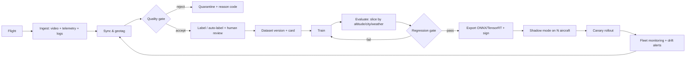

# UAV AI and Data Pipeline: Perception, Geospatial Data and Fleet Learning

**Created Date:** 2026-10-30
**Last Updated:** 2026-10-30
**Tags:** `#uav`, `#computer-vision`, `#edge-ai`, `#sensor-fusion`, `#vio`, `#visdrone`, `#tensorrt`, `#mlops`, `#geospatial`, `#small-object-detection`
**References:** Zhu et al., VisDrone (IEEE TPAMI 2021) · Du et al., UAVDT (2018) · Anti-UAV300/410/600 benchmarks · Meimetis et al., *Machines* 13(8):684 (2025) · Shakya et al., IEEE Access (2025/2026) · PX4/ArduPilot companion docs · Serve Robotics (2026)
**Status:** Review
**Difficulty:** Intermediate → Advanced

---

## 📌 Key Takeaways (TL;DR)

- UAV data is **not** web data with a camera attached. The camera moves, the objects are 10–30 pixels tall, the background changes with altitude, and the label that matters may be a *geographic coordinate* rather than a bounding box.
- Three distinct AI problems hide under "AI for UAV": **(1) fly safely** (state estimation, VIO, obstacle avoidance), **(2) see the world** (detection, tracking, segmentation, geolocalisation), **(3) decide** (routing, task allocation, energy-aware planning). They use different data, different metrics, different failure costs.
- The edge constraint is a **thermal and power** constraint before it is a FLOPs constraint: on a Jetson Orin Nano, measured detector power draw sits around 7.6–10.4 W, and sustained throttling in a sealed airframe is the real limit.
- TensorRT/FP16 typically buys **3–5×** latency improvement over PyTorch on the same Jetson — often more than switching model families. Optimise the runtime before swapping architectures.
- Small-object detection is the core technical difficulty: at 100 m altitude with a 4.4 µm pixel pitch and 8 mm lens, a 0.4 m person is ~14 px tall. State it with the GSD formula, not with adjectives.
- UAV datasets have a **domain-shift problem that is structural**: training on VisDrone (Chinese cities, specific altitudes) and deploying in a Vietnamese city at a different altitude is a distribution shift you can measure before you fly.
- Fleet learning is a **data flywheel**, and the hard parts are governance (privacy, retention, geofencing of imagery) and rollout (signed models, shadow mode, rollback) — not the training job.

---

## 🧠 Detailed Notes

### 1. Core Concepts

#### 1.1 The three AI problems, separated

| Layer | Question | Typical methods | Data | Metric | Failure cost |
|-------|----------|-----------------|------|--------|--------------|
| **Fly** | Where am I, what is around me, how do I not hit it? | EKF2, VIO/VSLAM, occupancy grids, DAA | IMU, camera, depth, LiDAR, GNSS, radar | Drift (m), latency (ms), miss rate | Crash |
| **See** | What is on the ground and where exactly? | Detection, tracking, segmentation, georeferencing, photogrammetry | RGB/thermal video, GNSS/IMU, GCPs | mAP, MOTA/HOTA, localisation error (m) | Wrong decision, privacy harm |
| **Decide** | Which customer, which order, which route, when to recharge? | Forecasting, optimisation, RL, heuristics | Demand, travel times, weather, energy | Cost, SLA violation, $CO_2e$ | Economic loss, SLA breach |

The mistake beginners make is to treat all three as "train a model". Only layer 2 is a classical ML problem; layer 1 is estimation/control, layer 3 is operations research (see `07`).

#### 1.2 Why aerial imagery breaks standard CV assumptions

| Assumption in web CV | Reality for UAV | Consequence |
|----------------------|-----------------|-------------|
| Objects are large (100+ px) | 8–40 px for people/cars at 80–120 m | Need high-resolution input, tiling, small-object heads |
| Camera is roughly level | Nadir/oblique, changing pitch and roll | Rotation/augmentation must be 3D-aware |
| Background is static | Motion blur, parallax, changing altitude | Domain shift across a single flight |
| Class distribution is stable | Density varies 100× between rural and market scenes | Sampling and loss weighting matter |
| Labels are cheap | 2.6 M boxes in VisDrone took a large team | Active learning, semi-supervision, synthetic data |
| Test set ≈ deployment set | New city, new season, new airframe | Measure shift; do not trust benchmark mAP |

#### 1.3 Ground Sample Distance (GSD): the number that explains everything

GSD is the real-world size of one pixel on the ground:

$$
\text{GSD} = \frac{p \cdot H}{f}
$$

where $p$ = pixel pitch (m), $H$ = altitude above ground (m), $f$ = focal length (m).

**Example.** $p = 4.4\ \mu m = 4.4\times10^{-6}$ m, $f = 8$ mm $= 8\times10^{-3}$ m, $H = 100$ m:

$$
\text{GSD} = \frac{4.4\times10^{-6} \times 100}{8\times10^{-3}} = 0.055\ \text{m/px} = 5.5\ \text{cm/px}
$$

A person 0.4 m wide occupies $0.4 / 0.055 \approx 7$ px; a 1.8 m tall person ≈ 33 px vertically. A car 4.5 m long ≈ 82 px. **This is why "small object detection" is the field's central problem**, and why altitude is a *hyperparameter of your dataset*, not a nuisance.

Corollary: doubling altitude halves object pixels and quadruples the area covered per frame. Every UAV mission is therefore an explicit trade between **coverage** and **detectability** — a decision you should record per dataset version.

#### 1.4 Onboard vs offboard inference

| Mode | Where | Latency | Bandwidth | Use when |
|------|-------|---------|-----------|----------|
| Fully onboard | Companion GPU | 5–50 ms | None | Safety, DAA, tracking, privacy |
| Onboard + cloud escalation | Edge → cloud | 100 ms–2 s | Bursts | Ambiguous scenes, high-value inspection |
| Store-and-forward | Edge records, cloud processes later | Minutes–hours | Bulk | Mapping, photogrammetry, audit |
| Cloud-only | Stream all video | Seconds | Very high | Only with dedicated link; never safety-critical |

The practical default for delivery drones: **onboard detection for anything that changes the flight, cloud processing for anything that changes the business** (damage reports, map updates, demand estimation).

---

### 2. How It Works (Mechanism)

#### 2.1 State estimation: the part that must never be an ML black box

PX4's **EKF2** fuses IMU, barometer, magnetometer, GNSS, optical flow, and external vision (VIO) into a state estimate. The fusion is a probabilistic filter with an explicit process/measurement model — auditable, certifiable, and predictable.

VIO pipeline in practice:

```
stereo/RGB-D frames ─┐
                     ├─► feature tracking ─► visual-inertial bundle adjustment ─► pose
IMU (200–1000 Hz) ───┘                              │
                                                    ▼
                                   EKF2 fuses VIO pose + IMU + baro + GNSS
                                                    │
                                                    ▼
                                       position/velocity controller
```

Why not "learn the pose with a neural net"? Because a learned estimator gives no calibrated covariance, fails unpredictably out of distribution, and is very hard to argue in a safety case. Learned components appear in *perception* and *planning*, not usually in the inner estimator.

#### 2.2 Perception stack anatomy

```
frame ─► preprocess (resize/letterbox, normalise)
      ─► detector (YOLO-class, TensorRT FP16/INT8)
      ─► tracker (ByteTrack / DeepSORT)  ─► track IDs + velocity
      ─► georeference (pose + camera model + terrain/plane assumption)
      ─► business logic (count, alert, deliver, avoid)
```

Key implementation facts:

- **Letterbox, don't squash.** Aspect-ratio distortion at inference is a silent accuracy leak.
- **Tile large frames.** A 4K nadir image downscaled to 640 px destroys small objects. Tile into overlapping crops, detect, then merge with NMS.
- **Track, don't re-detect identity.** Frame-level detection cannot give you "the same car over 30 frames"; a tracker can, and tracking is what enables counting, speed estimation, and DAA.
- **Georeference explicitly.** A bounding box without a ground coordinate is not actionable for delivery, inspection, or mapping.

#### 2.3 Georeferencing and photogrammetry (the "data product" side)

For mapping missions the output is not a label — it is a **georeferenced data product**:

1. Capture overlapping images (typically 70–80% forward, 60–70% side overlap).
2. Structure-from-Motion (SfM) recovers camera poses and a sparse point cloud.
3. Dense matching → point cloud / mesh; orthorectification → **orthomosaic**.
4. Absolute accuracy requires **ground control points (GCPs)** or **RTK/PPK GNSS**; without them, relative geometry can look perfect while absolute position is metres off.
5. Deliverables: orthomosaic (GeoTIFF), DSM/DTM, point cloud (LAS/LAZ), contour lines, volume measurements.

Critical distinction for AI work:

| Accuracy type | Meaning | How to get it |
|---------------|---------|---------------|
| Relative | Shape/consistency within the model | Good overlap + SfM |
| Absolute | Correct position on the Earth | GCPs or RTK/PPK |
| Temporal | Same place, comparable across dates | Fixed flight plan, same altitude/heading, sun-angle matching |

A model trained on one orthomosaic and applied to another captured at a different altitude and season is a textbook domain-shift experiment. Make the shift *explicit* in the dataset card.

#### 2.4 Edge deployment: the real optimisation ladder

Order of interventions by return on effort (measured on Jetson-class hardware):

| Step | Typical gain | Cost | Risk |
|------|--------------|------|------|
| 1. Fix preprocessing (no per-frame CPU copies, zero-copy CSI) | 1.2–2× | Low | Low |
| 2. Export to ONNX → TensorRT FP16 | 3–5× vs PyTorch | Low | Low (accuracy check needed) |
| 3. Batch/tile scheduling, pinned memory, CUDA streams | 1.2–1.5× | Medium | Medium |
| 4. INT8 with calibration | 1.5–2× over FP16 | Medium | Accuracy drop on small objects |
| 5. Smaller architecture / distillation | 2–4× | High (retrain) | Accuracy drop |
| 6. Pruning / structured sparsity | 1.2–1.5× | High | Tooling fragility |

The empirical benchmark literature on UAV edge detection (VisDrone/DOTA/xView, Jetson Orin Nano, TensorRT FP16) reports this shape: **YOLOv8-Nano and YOLOv9-Tiny lead on accuracy, YOLOv6-Nano and YOLOv10-Nano trade accuracy for speed and memory**, and no single model dominates every objective — the Pareto frontier is the honest deliverable, not a single "best model".

#### 2.5 The data pipeline end to end



Quality gates that pay for themselves:

- **Blur gate** — Laplacian variance below threshold → discard frame (a blurred label is worse than no label).
- **Altitude/pose gate** — reject frames whose pose is unavailable; a detection without a pose cannot be georeferenced.
- **Duplicate/near-duplicate detection** — perceptual hash; consecutive frames inflate the dataset and leak across train/val.
- **Label provenance** — human / auto-labelled / synthetic, with reviewer ID. Never mix silently.
- **Split by flight, not by frame.** Frame-level random splits leak the same scene into train and test and inflate mAP by a large margin. Split by `flight_id` and, ideally, by city/date.

#### 2.6 Metrics that survive contact with operations

| Task | Benchmark metric | Operational metric you actually need |
|------|------------------|--------------------------------------|
| Detection | mAP@0.5, mAP@0.5:0.95 | Recall at the operating threshold, per distance band; false alarms per flight hour |
| Small objects | AP-small | Recall for objects < 20 px, at max mission altitude |
| Tracking | MOTA / HOTA / IDF1 | ID switches per minute; track fragmentation |
| Geolocalisation | — | 2D position error (m), p50/p95 |
| Mapping | RMSE vs GCP | Absolute RMSE (m) at the project's required scale |
| Whole system | — | Delivery success rate, intervention rate per 100 km, cost per delivery |

Reporting only mAP is how teams ship models that look excellent and fail at the actual altitude.

#### 2.7 MLOps for a fleet (not for a server)

| Server MLOps | Fleet MLOps | Added difficulty |
|--------------|-------------|------------------|
| Model registry | Registry + **hardware compatibility matrix** | TensorRT engines are device/version specific |
| Canary by traffic % | Canary by **aircraft subset** | A bad model can crash, not just annoy |
| Monitoring latency/errors | Monitoring **detections per flight, link quality, thermal** | Labels arrive late (after review) |
| Retrain on new data | Retrain + **regulatory change log** | Model behaviour may be part of a safety case |
| Rollback in seconds | Rollback must be **offline-capable** | Aircraft may be in the field with no link |

Non-negotiable practices: signed model artefacts, model + preprocessing + calibration bundled as one versioned unit, A/B in shadow mode (run new model, log its output, do not act on it), and an explicit "minimum battery/link state to accept an update" rule.

#### 2.8 Privacy and data governance (the part that gets projects cancelled)

Aerial imagery is uniquely invasive: it captures private gardens, faces, licence plates, and patterns of life.

- **Data minimisation at capture** — fly the mission you need; avoid hovering over private property.
- **On-device redaction** — blur faces/plates before storage when the business does not need them.
- **Retention schedule** — raw video 7–30 days, derived labels longer, with documented justification.
- **Access control + audit** — who viewed which flight, when; this is the same least-privilege principle as database RLS.
- **Geofence the dataset, not just the aircraft** — exclude sensitive areas from training data collection.
- **Legal basis** — GDPR-style consent/legitimate-interest analysis in the EU; sector rules elsewhere. Note that "it was in public airspace" is not a privacy argument.

---

### 3. Implementation

#### 3.1 GSD and object-size calculator (runnable, use before choosing a model)

```python
#!/usr/bin/env python3
"""Plan a mission: what will an object look like at this altitude?"""

def gsd_cm_per_px(pixel_pitch_um: float, altitude_m: float, focal_mm: float) -> float:
    p = pixel_pitch_um * 1e-6
    f = focal_mm * 1e-3
    return (p * altitude_m / f) * 100  # cm/px

def object_px(size_m: float, gsd_cm: float) -> float:
    return (size_m * 100) / gsd_cm

if __name__ == "__main__":
    # 20 MP 1" sensor: ~2.4 um pitch, 8.8 mm lens (typical compact payload)
    for alt in (50, 80, 100, 120):
        g = gsd_cm_per_px(2.4, alt, 8.8)
        print(f"alt={alt:3d} m  GSD={g:5.2f} cm/px  "
              f"person={object_px(0.45, g):5.1f} px  car={object_px(4.5, g):6.1f} px")
```

Expected shape of the output (numbers depend on your sensor):

```
alt= 50 m  GSD= 1.36 cm/px  person= 33.0 px  car= 330.0 px
alt= 80 m  GSD= 2.18 cm/px  person= 20.6 px  car= 206.3 px
alt=100 m  GSD= 2.73 cm/px  person= 16.5 px  car= 165.0 px
alt=120 m  GSD= 3.27 cm/px  person= 13.8 px  car= 137.5 px
```

Design consequence: if your operational ceiling is 120 m and you need 30 px on a person, you need either a longer lens, a higher-resolution sensor, or a lower flight altitude — **not** a bigger model.

#### 3.2 ONNX → TensorRT export and latency check

```python
# pip install ultralytics onnx onnxruntime  (TensorRT on the Jetson via JetPack)
from ultralytics import YOLO

model = YOLO("yolov8n.pt")
model.export(format="onnx", imgsz=640, opset=12, simplify=True, dynamic=False)

# On the Jetson:
#   trtexec --onnx=yolov8n.onnx --fp16 --saveEngine=yolov8n_fp16.engine \
#           --warmUp=500 --duration=10 --avgRuns=100
# Record p50/p95 latency, not the mean; run inside the real enclosure at ambient temperature.
```

Checklist before trusting the engine:

- [ ] Same preprocessing in PyTorch and TensorRT (letterbox values, normalisation, colour order)
- [ ] Accuracy parity on a fixed 500-image holdout: ΔmAP < 1 point
- [ ] p95 latency under the *operational* frame budget (not the benchmark budget)
- [ ] Sustained 10-minute run at ambient temperature — watch for throttle
- [ ] Memory peak fits alongside the rest of the stack (ROS 2, logging, comms)

#### 3.3 Dataset split and evaluation harness (the anti-leakage part)

```python
import pandas as pd

df = pd.read_csv("frames.csv")  # columns: path, flight_id, city, altitude_m, split

def assert_no_leakage(df, eps_alt=10):
    # 1) same flight must never appear in two splits
    g = df.groupby("flight_id")["split"].nunique()
    assert (g == 1).all(), f"flights split across sets: {g[g > 1].index.tolist()}"
    # 2) report altitude coverage per split, so shift is visible
    print(df.groupby(["split", "city"])["altitude_m"]
            .agg(["count", "min", "max", "mean"]).round(1))

assert_no_leakage(df)
```

Then evaluate with **sliced metrics** — never a single aggregate:

```python
def sliced_report(preds, gts, meta):
    for lo, hi in [(0, 60), (60, 90), (90, 120)]:
        m = (meta.altitude_m >= lo) & (meta.altitude_m < hi)
        print(f"alt {lo}-{hi} m  n={m.sum():5d}  recall={recall(preds[m], gts[m]):.3f}")
```

If recall at 90–120 m is 0.55 while the aggregate is 0.82, the aggregate is a lie about the mission.

#### 3.4 Fleet drift monitor (what to alert on)

| Signal | Why | Alert rule (example) |
|--------|-----|----------------------|
| Detections per flight-minute | Sudden drop = model or camera fault | < 50% of 7-day median |
| Mean confidence | Calibration drift | > 0.05 shift over 3 days |
| Class mix | Scene/route change or new city | Jensen–Shannon > 0.1 vs baseline |
| Inference latency p95 | Thermal throttle or engine mismatch | > 1.5× baseline |
| Intervention rate | Human takeover per 100 km | > 2× baseline |
| Link-related aborts | C2 degradation masquerading as autonomy failure | Trend, not threshold |

---

### 4. Practical Application

#### 4.1 Worked scenario: delivery drone with a downward camera

Mission: deliver 2 kg parcels, 8 km round trip, 80 m altitude, urban periphery.

1. **GSD at 80 m** ≈ 2.2 cm/px (compact payload) → a person is ~20 px, a scooter ~90 px.
2. **Onboard tasks**: detect people/vehicles in the descent corridor, track them for 1 s, avoid hovering over them. Model budget: ≤ 15 ms p95.
3. **Cloud tasks**: build the delivery-zone map, detect changed obstacles (construction), estimate demand.
4. **Data**: label only the descent corridor and the last 30 m — labelling the whole flight is waste.
5. **Metrics**: recall at 80 m for people on the descent path (target ≥ 0.95), false-alarm rate per delivery (target < 0.1), geolocation error < 1.5 m.
6. **Governance**: on-device blur of faces; raw video retained 14 days; training set excludes residential interiors.

#### 4.2 Where UAV AI actually earns money (vs where it is a demo)

| Application | Value driver | Maturity | Notes |
|-------------|--------------|----------|-------|
| Inspection (power lines, rooftops, bridges) | Avoided scaffolding + faster cycles | High | Defect detection with human review; georeferenced evidence is the product |
| Agriculture (spraying, crop stress) | Input savings, yield | High | Area-based routing (not point-based) changes the optimisation problem |
| Surveying / mapping | Labour + accuracy | Very high | RTK + GCP discipline decides quality |
| Delivery | Cost per parcel, speed | Medium | Constrained by regulation, payload, and energy |
| Security / counter-UAS | Risk reduction | Medium | Adversarial domain: tiny, fast targets |
| Search and rescue | Lives | Medium | Thermal + geolocation; recall matters more than precision |

#### 4.3 The data flywheel, honestly

Commercial fleet operators describe the loop as *more data → better models → better robots → more revenue → more robots → more data*. The loop is real, but it has three friction points that are easy to hide in a pitch deck:

1. **Label cost grows faster than data volume** unless you invest in auto-labelling + human verification.
2. **Regulatory review** can freeze a model version mid-loop.
3. **Long-tail events** (rare obstacles) are exactly the ones you need and exactly the ones you have least of — synthetic data and simulation help, but only if the sim-to-real gap is measured.

---

### 5. Comparison Tables

#### 5.1 UAV vision datasets

| Dataset | Size | Domain | Tasks | Strength | Limitation |
|---------|------|--------|-------|----------|------------|
| **VisDrone2019** | 288 clips / 261,908 frames + 10,209 images; 2.6 M boxes; 14 cities | Urban/rural China, multiple platforms | Detection (image/video), SOT, MOT, counting | De-facto benchmark, rich attributes | Altitude/city bias; crowded scenes dominate |
| **UAVDT** | ~80,000 frames, 10 h, 1080×540, 30 fps | Vehicles in complex scenarios | DET, SOT, MOT | Vehicle-centric, 14 attributes | Low resolution by modern standards |
| **Anti-UAV300/410/600** | 300+ sequences, RGB + IR | Small fast UAV targets | Tracking with disappearance flags | Adversarial small-target tracking | Narrow task; not a general perception benchmark |
| **DOTA-v1.5** | Large aerial scene set | Satellite/aerial, oriented boxes | Oriented detection | Real geospatial scale | Not drone-altitude; different optics |
| **xView** | Large overhead set | Satellite | Detection | Extreme small-object regime | Domain far from delivery drones |

#### 5.2 Edge compute options (order-of-magnitude, check current specs before buying)

| Platform | Class | Strength | Constraint | Best for |
|----------|-------|----------|------------|----------|
| ESP32 / STM32 | MCU | µW–mW, hard real-time | No vision beyond tiny CNN | Sensors, actuators, flight-adjacent control |
| Raspberry Pi 5 | SBC | Cheap, Linux, good I/O | No strong GPU; thermal | Telemetry gateway, light CV |
| Jetson Orin Nano | Edge GPU | 10–40 TOPS class, TensorRT | ~7–15 W, thermal design needed | Perception, VIO, small fleets |
| Jetson Orin NX / AGX | Edge GPU | 70–275 TOPS class | Power + cost + mass | Multi-camera fusion, on-board mapping |
| Cloud GPU | Datacenter | Unlimited for training | Latency + link | Training, photogrammetry, hard-case escalation |

#### 5.3 "Is this model deployable?" checklist

| Check | Fail example |
|-------|--------------|
| Trained/validated split by flight, not frame | mAP 0.9 that collapses to 0.5 in the field |
| Metrics sliced by altitude/weather/city | Aggregate hides the mission-critical band |
| p95 latency inside the real budget | "Average 20 ms" but 120 ms spikes |
| Thermal soak test in the enclosure | Throttles after 4 minutes |
| Precision/recall at the *operating* threshold | Great mAP, unusable false-alarm rate |
| Model + preprocessing versioned together | Engine mismatch after OTA |
| Privacy redaction in the pipeline | Faces in stored video |

---

## 🔗 Tech Cross-References (Section K)

- **Databases** — flight telemetry, labels, and model versions are a schema problem: time-series tables, foreign keys from label → frame → flight, and indexes that make sliced evaluation fast → [`../dev_foundation/databases/README.md`](../dev_foundation/databases/README.md)
- **MLOps / deployment** — model registry, drift monitoring, staged rollout and rollback are the same discipline, with physical consequences → [`../ai_ml/05-mlops-lifecycle-and-deployment-architecture.md`](../ai_ml/05-mlops-lifecycle-and-deployment-architecture.md)
- **Complexity & data structures** — tiling, NMS, tracking association and top-k selection are DSA problems with real latency budgets → [`../dev_foundation/dsa/04-complexity-analysis-toolkit.md`](../dev_foundation/dsa/04-complexity-analysis-toolkit.md)
- **Linux / Docker** — TensorRT engines are tied to driver + CUDA versions; containerising the inference stack is how you reproduce a result six months later → [`../dev_foundation/docker/README.md`](../dev_foundation/docker/README.md)
- **YAML / config** — dataset cards, training configs and deployment manifests are config-as-code; a wrong `imgsz` silently changes accuracy → [`../dev_foundation/yaml_config/README.md`](../dev_foundation/yaml_config/README.md)
- **IoT telemetry** — the data ingestion side is MQTT/HTTP batching with store-and-forward → [`02-mqtt-simulation-testing-system.md`](02-mqtt-simulation-testing-system.md)

## 🔗 Related Topics

- [`05-uav-iot-stack-and-c2-links.md`](05-uav-iot-stack-and-c2-links.md) — the vehicle, the compute split, and the link that constrains what data can leave the aircraft
- [`07-uav-logistics-terminology-and-optimization.md`](07-uav-logistics-terminology-and-optimization.md) — layer 3 ("decide"): TSP-D/VRP-D, MILP, continuous approximation, genetic algorithms, GHG accounting
- [`../ai_ml/08-fraud-detection-foundations.md`](../ai_ml/08-fraud-detection-foundations.md) — the same evaluation discipline (thresholds, imbalance, sliced metrics) in a non-physical domain
- [`../ai_ml/07-affective-computing-and-emotion-recognition.md`](../ai_ml/07-affective-computing-and-emotion-recognition.md) — a worked example of why published accuracy is not a target
- [`../dev_foundation/security/01-web-security-injection-xss-csrf-session-hijacking.md`](../dev_foundation/security/01-web-security-injection-xss-csrf-session-hijacking.md) — why imagery pipelines need output encoding/redaction too
- [SUGGESTED] **Synthetic data and sim-to-real for aerial perception** — why rendering (Unreal/Isaac Sim) plus domain randomisation is now standard, and how to measure the reality gap. Important because the long tail is unbuyable.
- [SUGGESTED] **Thermal and power budgeting for edge AI** — `iot_aiot/`: sustained watts, not TOPS, decide what runs on the aircraft. Important because every deployment failure I have seen in this space was thermal.
- [SUGGESTED] **Geographic information systems (CRS, projections, GeoJSON/PostGIS)** — `dev_foundation/databases/`: a georeferenced detection is a spatial join, and coordinate-system mistakes are silent and expensive.

## 🤔 Open Questions

- [ ] For a Vietnamese city, what is the realistic domain gap from VisDrone, and can it be closed with 2,000 locally labelled frames or does it need 20,000?
- [ ] How much accuracy is lost by INT8 calibration on sub-20-pixel objects specifically, and is per-channel calibration enough?
- [ ] Is monocular geolocalisation (flat-ground assumption) accurate enough for delivery drop zones, or is stereo/RTK mandatory?
- [ ] What is the right labelling policy for "person" in a privacy-sensitive deployment — bounding box, mask, or on-device-only detection with no persistence?
- [ ] Can tracking replace per-frame detection for 80% of frames without hurting DAA recall?

---

*Feynman check: "A drone camera at 100 m makes a person about 16 pixels tall. So the AI is not recognising a person the way you do — it is guessing from a smudge. That's why we compute the pixel size before we choose the model, and why we test at the real altitude instead of on pretty benchmark photos."*
